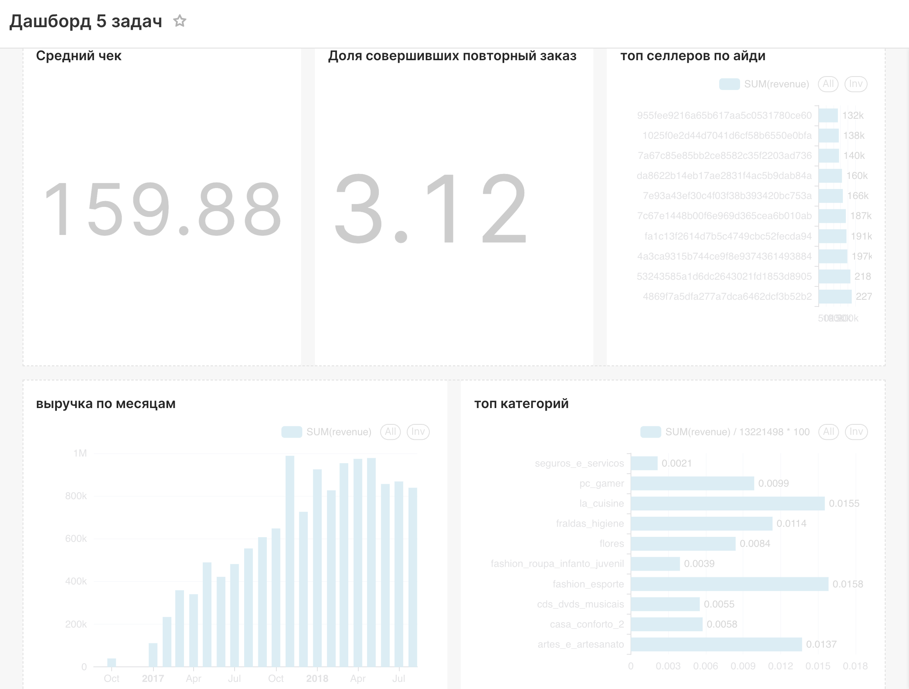

# Дашборд пяти бизнес-вопросов

Скриншот текущего дашборда Superset, предоставленный пользователем.

Данные: `mart.monthly_sales`, `mart.seller_sales`, `mart.order_summary`,
`mart.customer_summary`, `mart.category_sales` в PostgreSQL DWH.
SQL для вопросов и определения метрик: [инструкция](../../analysis/business_questions/sql/README.md).

На скриншоте сохранён текущий вид. Для графика «топ категорий» следует
сортировать категории по `revenue DESC` и использовать готовое поле
`revenue_share_pct`: знаменатель не нужно задавать константой.
Доля повторных покупателей — 3,12%, средний чек — 159,88 BRL.
Скриншот является иллюстрацией, не экспортом конфигурации Superset.
